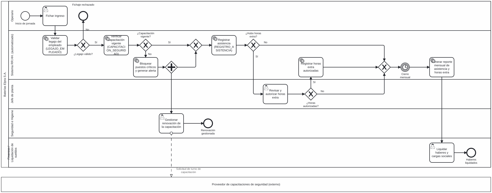

# Sistema Centralizado de Gestión de Recursos Humanos — Baterías Elpra S.A.

> **Trabajo Práctico Integrador y Progresivo (TPI) · Entrega N.º 4: Procesos, Trabajo Colaborativo y Control Integrador**
> Organización Empresarial · Tecnicatura Universitaria en Programación a Distancia · Universidad Tecnológica Nacional (UTN)

| | |
|---|---|
| **Grupo** | N.º 15 |
| **Integrantes** | Cristian Ahumada · Tomas Ahumada |
| **Docente titular** | Prof. Gabriela Martínez |
| **Docente tutor** | Ricciuto María Lourdes |
| **Tablero de gestión** | [GitHub Projects](https://github.com/users/cusquitonet/projects/3) |

---

## 1. Descripción del sistema

**Baterías Elpra S.A.** es una empresa industrial dedicada al reciclado de baterías, la comercialización de plomo procesado (lingotes o conos) y de plástico molido recuperado. Cuenta además con la unidad **Elpra Electric**, que ensambla y comercializa motos eléctricas. La fabricación de baterías nuevas está **tercerizada**: Elpra entrega el plomo que recicla como materia prima al fabricante externo y luego comercializa las baterías.

Hoy la gestión del personal se realiza con planillas de Excel desarticuladas. Este proyecto propone un **software centralizado de Recursos Humanos** que:

- Centraliza los **legajos** del personal de planta y de oficinas.
- Automatiza el **control de asistencia y horas extra**, con datos confiables para la liquidación de haberes.
- Controla las **capacitaciones obligatorias de seguridad e higiene** (manejo de plomo y ácido) y restringe la asignación a puestos críticos cuando están vencidas.

**Objetivo general:** automatizar el control de asistencia, el seguimiento de legajos y las capacitaciones de seguridad, optimizando la toma de decisiones y reduciendo los tiempos de procesamiento operativo.

### Alcance de este repositorio

Este repositorio aloja la **documentación técnica** del proyecto (no el código fuente del software) y consolida las cuatro entregas del TPI.

---

## 2. Estructura del repositorio

```
/
├── README.md
└── docs/
    ├── entregas/
    │   ├── entrega-1-sistema-abierto.pdf
    │   ├── entrega-2-foda-objetivos-gantt.pdf
    │   ├── entrega-3-organigrama-diccionario-datos.pdf
    │   └── entrega-4-consolidada.pdf
    ├── bpmn/
    │   ├── proceso-asistencia.bpmn
    │   └── proceso-asistencia.png
    └── control/
        ├── indicadores-control.md
        └── tablero-1.png, tablero-2.png, tablero-3.png
```

## 3. Resumen de las entregas

| Entrega | Contenido | Documento |
|---|---|---|
| **1** | Modelado de Baterías Elpra S.A. como sistema abierto (TGS) e interdependencia del módulo de RR.HH. | [Ver PDF](docs/entregas/entrega-1-sistema-abierto.pdf) |
| **2** | Análisis FODA del proyecto, objetivo general, metas cuantitativas y planificación temporal (Gantt de 12 semanas). | [Ver PDF](docs/entregas/entrega-2-foda-objetivos-gantt.pdf) |
| **3** | Organigrama formal y diccionario de datos inicial (`LEGAJO_EMPLEADO`, `REGISTRO_ASISTENCIA`, `CAPACITACION_SEGURIDAD`). | [Ver PDF](docs/entregas/entrega-3-organigrama-diccionario-datos.pdf) |
| **4** | Modelado BPMN, control de versiones, backlog ágil, indicadores de control y declaración de uso de IA. | [Ver PDF](docs/entregas/entrega-4-consolidada.pdf) |

---

## 4. Modelado de procesos (BPMN)

**Proceso modelado:** *Registro de asistencia y habilitación para operar en planta.*
Es el proceso que el software automatiza y el que integra las tres entidades del diccionario de datos.



📁 Archivo editable: [`proceso-asistencia.bpmn`](docs/bpmn/proceso-asistencia.bpmn) (abrir en [bpmn.io](https://demo.bpmn.io)).

### Estructura

| Elemento | Detalle |
|---|---|
| **Pool 1** | Baterías Elpra S.A. |
| **Lanes** | Operario · Sistema RR.HH. (automatizado) · Jefe de planta · Recursos Humanos · Seguridad e Higiene · Finanzas / Liquidación |
| **Pool 2 (externo)** | Proveedor de capacitaciones de seguridad (pool colapsado, conectado por flujo de mensaje) |

### Flujo estándar

Inicio de jornada → Fichar ingreso → Validar legajo → Verificar capacitación vigente → Registrar asistencia de ingreso → Fichar egreso → Calcular horas trabajadas y detectar horas extra → Cierre mensual → Generar reporte mensual → Revisar y validar el reporte (RR.HH.) → Liquidar haberes → Fin.

### Compuertas de decisión (excepciones)

| Compuerta | Si la respuesta es "No" |
|---|---|
| **¿Legajo válido?** | Se rechaza el fichaje y RR.HH. regulariza el legajo (fin: *Legajo regularizado*). |
| **¿Capacitación vigente?** | El sistema bloquea los puestos críticos y genera una alerta. En paralelo (compuerta paralela), Seguridad e Higiene gestiona la renovación (mensaje al proveedor externo) y la asistencia se registra igualmente. |
| **¿Hubo horas extra?** | El flujo continúa directamente al cierre mensual. |
| **¿Horas autorizadas?** | Las horas extra se excluyen del cómputo y el flujo continúa al cierre mensual. |

> **Versión 2 del diagrama:** se agregó la lane de Recursos Humanos (regularización de legajos y validación del reporte mensual) y el fichaje de egreso, de modo que las horas extra se calculan al finalizar la jornada y no al ingresar.

---

## 5. Flujo de trabajo con Git y GitHub

### Ramas

| Rama | Uso |
|---|---|
| `main` | Versión estable y revisada de la documentación. No se commitea directamente. |
| `docs/readme` | Redacción del README. |
| `docs/bpmn` | Diagrama BPMN. |
| `docs/backlog` | Historias de usuario y tablero. |
| `docs/control` | Indicadores de control y declaración de IA. |

### Convención de commits

Formato: `tipo: descripción en presente e imperativo`

| Tipo | Uso | Ejemplo |
|---|---|---|
| `docs` | Documentación nueva o modificada | `docs: agrega diagrama BPMN del proceso de asistencia` |
| `fix` | Corrección de un error | `fix: corrige compuerta de capacitación vencida en BPMN` |
| `refactor` | Reorganización sin cambiar el contenido | `refactor: reorganiza carpetas de documentación` |
| `chore` | Tareas de mantenimiento | `chore: agrega entregas 1 a 3 en formato PDF` |

### Pull Requests con revisión de pares

- Cada rama se integra a `main` mediante un **Pull Request**.
- El PR lo abre un integrante y lo **revisa el otro**, con comentarios y, si corresponde, solicitud de cambios antes de aprobar.
- Cada PR referencia su historia de usuario con `Closes #n`.

| PR | Descripción | Autor | Revisor | Estado |
|---|---|---|---|---|
| [#1](https://github.com/cusquitonet/elpra-rrhh-documentacion/pull/1) | Reemplazo de versiones de varios archivos con errores o inconsistencias por versiones corregidas (commit `bd1da10`) | Cristian Ahumada | Tomas Ahumada | Aprobado y mergeado |
| [#2](https://github.com/cusquitonet/elpra-rrhh-documentacion/pull/2) | Reemplazo de versiones de varios archivos con errores o inconsistencias por versiones corregidas (commit `1c93bc9`) | Tomas Ahumada | Cristian Ahumada | Aprobado y mergeado |

Ambos Pull Requests recibieron comentarios de los dos integrantes. Como los cambios consistían en reemplazar versiones de varios archivos por versiones corregidas, comparar cada archivo con su versión anterior simplificó verificar que las correcciones se aplicaran bien. [Ver PRs cerrados](https://github.com/cusquitonet/elpra-rrhh-documentacion/pulls?q=is%3Apr+state%3Aclosed).

---

## 6. Gestión del backlog ágil

Tablero: [**GitHub Projects**](https://github.com/users/cusquitonet/projects/3), con las columnas **Por Hacer → En Progreso → Listo**. Cada historia de usuario es un *Issue* del repositorio vinculado al tablero.

| ID | Historia de usuario | Issue | Estado |
|---|---|---|---|
| **HU1** | **Como** analista de RR.HH., **quiero** registrar y consultar los legajos de los empleados en un único sistema, **para** eliminar las planillas de Excel desarticuladas y contar con datos confiables. | [#1](https://github.com/cusquitonet/elpra-rrhh-documentacion/issues/1) | Listo |
| **HU2** | **Como** jefe de planta, **quiero** registrar la asistencia y las horas extra diarias de mi personal, **para** que Finanzas liquide los haberes sin errores de transcripción. | [#2](https://github.com/cusquitonet/elpra-rrhh-documentacion/issues/2) | Listo |
| **HU3** | **Como** responsable de Seguridad e Higiene, **quiero** ser alertado de las capacitaciones vencidas y restringir la asignación a puestos críticos, **para** cumplir las auditorías y prevenir riesgos por manejo de plomo y ácido. | [#3](https://github.com/cusquitonet/elpra-rrhh-documentacion/issues/3) | Listo |

### Trazabilidad con el modelo

| Historia | Entidad del diccionario de datos | Tareas del BPMN |
|---|---|---|
| HU1 | `LEGAJO_EMPLEADO` | Validar legajo del empleado · Regularizar legajo |
| HU2 | `REGISTRO_ASISTENCIA` | Registrar asistencia de ingreso · Fichar egreso · Calcular horas · Revisar y autorizar horas extra · Registrar horas extra autorizadas |
| HU3 | `CAPACITACION_SEGURIDAD` | Verificar capacitación vigente · Bloquear puestos críticos · Gestionar renovación |

### Evidencia de seguimiento

Capturas del tablero en distintos momentos del proyecto:

| Momento | Captura |
|---|---|
| Backlog inicial (todo en *Por Hacer*) | `docs/control/tablero-1.png` |
| Trabajo en curso (*En Progreso*) | `docs/control/tablero-2.png` |
| Cierre de la entrega (*Listo*) | `docs/control/tablero-3.png` |

---

## 7. Mecanismos de control

El control sigue el ciclo de la etapa de Dirección y Control: **fijar un estándar → medir → comparar → corregir**. Los estándares provienen de las metas cuantitativas definidas en la Entrega 2 y de los requisitos de seguridad del negocio.

| N.º | Indicador | Fórmula | Estándar (meta) | Frecuencia | Responsable | Acción correctiva |
|---|---|---|---|---|---|---|
| 1 | Tiempo de generación del reporte mensual | Tiempo de respuesta medido en segundos | ≤ 3 s (hasta 500 colaboradores) | En cada cierre mensual | Equipo técnico / QA | Optimizar consultas e índices de la base de datos |
| 2 | Legajos migrados desde Excel | (Legajos migrados ÷ legajos activos) × 100 | 100 % antes de las pruebas de usuario | Única vez, al migrar | Administrador de BD | Reprocesar los registros fallidos |
| 3 | Tasa de adopción del sistema | (Usuarios activos ÷ usuarios previstos) × 100 | > 95 % durante el primer mes | Semanal | Líder de proyecto / RR.HH. | Reforzar la capacitación y el acompañamiento |
| 4 | Operarios con capacitación vigente en puestos críticos | (Operarios habilitados ÷ operarios en puestos críticos) × 100 | 100 % | Diaria | Seguridad e Higiene | Bloqueo automático y alerta de renovación |
| 5 | Errores de carga en asistencia y horas extra | (Registros corregidos ÷ registros totales) × 100 | < 1 % | Mensual | Jefe de planta / RR.HH. | Revisar validaciones del sistema |
| 6 | Cumplimiento del cronograma | Semanas reales ÷ semanas planificadas | ≤ 12 semanas | Semanal | Líder de proyecto | Replanificar tareas según el Gantt |
| 7 | Horas extra autorizadas | (Empleados con horas extra autorizadas ÷ empleados con horas extra detectadas) × 100 | 100 % | Diaria, al cierre de la jornada | Jefe de planta | Excluir las horas no autorizadas y reforzar el control |

> La medición del indicador 1 se realizará con una base de **datos sintéticos** de 500 colaboradores, porque el FODA reconoce como debilidad la falta de un entorno de pruebas equivalente al de producción.
>
> Los indicadores 1 a 3 derivan de las metas cuantitativas de la Entrega 2. Los indicadores 4 a 7 se incorporan en esta entrega para cubrir seguridad, calidad de datos, seguimiento del cronograma y autorización de horas extra (el 7 deriva del criterio de aceptación de la HU2). Los valores del estándar 5 son una propuesta del grupo.

---

## 8. Declaración de Uso de IA

### Herramientas utilizadas

| Entrega | Herramienta | Propósito |
|---|---|---|
| 1, 2 y 3 | Gemini | Estructuración y redacción de contenidos, esquema sistémico, organigrama, diccionario de datos, matriz FODA y diagrama de Gantt (ver cada declaración). |
| 4 y consolidación | Claude | Explicación de consignas, plan de trabajo, archivo BPMN base, README, indicadores de control, guía de GitHub, detección de inconsistencias entre entregas y generación de los documentos corregidos. |

### Prompts utilizados y correcciones humanas

| N.º | Prompt (resumen) | Por qué se formuló así | Qué devolvió la IA | Corrección humana |
|---|---|---|---|---|
| 1 | Se adjuntaron las Entregas 1 a 3 aprobadas y la consigna de la Entrega 4, y se pidió el texto de presentación, una guía para las actividades y la explicación de las consignas ambiguas. | Se dio el contexto completo para que el resultado fuera coherente con el caso Elpra y con la rúbrica, y no genérico. | Explicación de las consignas, plan de trabajo, textos base, historias de usuario y propuesta de indicadores. También señaló que las historias de usuario no figuraban en las entregas previas. | El grupo contrastó las propuestas con sus entregas y validó las historias de usuario y los estándares a partir de las metas de la Entrega 2. |
| 2 | Se pidió el archivo .bpmn del proceso de asistencia para importarlo en bpmn.io, y luego el README y la guía de GitHub. | Se eligió bpmn.io por ser gratuita y estándar, y se pidió que el proceso integrara las tres entidades del diccionario. | Un BPMN con 2 pools, 5 lanes y 4 compuertas; un README y una guía paso a paso. | Tras la revisión de coherencia, el grupo solicitó agregar la lane de RR.HH. y el fichaje de egreso. Además, detectó que la ruta indicada para vincular el tablero al repositorio no existía en la interfaz de GitHub; la IA la verificó en la documentación oficial y la corrigió. |
| 3 | Se pidió revisar las inconsistencias entre las entregas y luego aplicar las decisiones del grupo y generar los PDF corregidos. | La consolidación exige coherencia entre documentos y la cátedra califica los errores del modelo como errores del grupo. | Lista priorizada de inconsistencias, versión 2 del BPMN y documentos corregidos. | El grupo decidió cómo resolver cada punto: fabricación tercerizada con entrega de plomo al fabricante, «unidad de negocios», alcance inicial del diccionario y campos de ampliación futura. |

### Errores o inconsistencias detectados

| Detalle | Cómo se resolvió |
|---|---|
| Las Entregas 1 y 2 describían fabricación propia de baterías, en contradicción con la tercerización de la Entrega 3. | Se unificó con la Entrega 3: Elpra recicla el plomo, lo entrega como materia prima al fabricante externo y comercializa las baterías. Se reescribió la Entrega 1 y se rehízo el esquema sistémico. |
| La descripción de `id_empleado` en `CAPACITACION_SEGURIDAD` era contradictoria con `estado_aprobacion`. | Se corrigió la descripción y se agregaron `id_registro` y `fecha_realizacion`. |
| La primera versión del BPMN omitía a RR.HH. y evaluaba las horas extra antes del fichaje de egreso. | Se agregaron la lane de RR.HH. y el fichaje de egreso. |
| La guía de GitHub indicaba una ruta inexistente para vincular el proyecto al repositorio. | Se verificó en la documentación oficial y se corrigió el procedimiento. |

El detalle completo figura en el *Registro de correcciones* del PDF consolidado.

### Responsabilidad intelectual

El grupo revisó, editó y validó críticamente todo el contenido presentado, y asume la total responsabilidad sobre su veracidad y coherencia conceptual, conforme a la Declaración de Transparencia de la cátedra.

---

## 9. Licencia y uso

Documentación elaborada con fines académicos para la cátedra de Organización Empresarial (UTN). Baterías Elpra S.A. se utiliza como caso de estudio.
